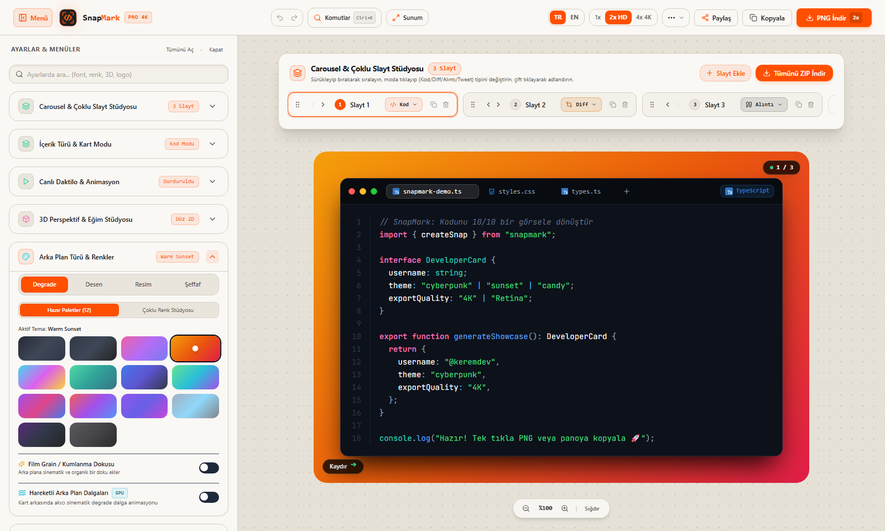

# 📸 SnapMark — 4K Code, Diff & Social Media Carousel Studio
### *Next-Generation Developer Screenshot & Multi-Slide Presentation Atelier*

<div align="center">

[](https://nextjs.org/)
[](https://www.typescriptlang.org/)
[](https://tailwindcss.com/)
[](https://prismjs.com/)
[](https://github.com)
[](./LICENSE)

**[🇹🇷 Switch to Turkish / Türkçe Kılavuza Git (README.md)](./README.md)**

</div>

---

<div align="center">
  
</div>

---

## 🎯 1. Overview & Problem Solved

Sharing snippets, technical tutorials, and product updates on social media (X/Twitter, LinkedIn, Instagram) is notoriously frustrating. Developers struggle with manual screenshots, fuzzy font scaling, inconsistent backgrounds, and broken code alignment. While tools like Carbon and Ray.so support basic code snippets, they do not accommodate multi-slide carousel posts, which generate the highest technical engagement on LinkedIn and Instagram.

**SnapMark** is a standalone, open-source, 100% client-side studio engineered to transform code snippets, Git diffs, tweet quotes, and terminal sessions into publication-ready **4K Ultra HD social media cards and multi-slide carousels** with single-click bulk ZIP export.

Everything is processed client-side inside browser memory; your code and sensitive tokens never touch any backend server.

---

## ⚖️ 2. Comparison Matrix

| Capability | SnapMark | Carbon.now.sh | Ray.so |
|:---|:---:|:---:|:---:|
| **Multi-Slide Carousel & Bulk ZIP** | ✅ **Built-in (Drag & Drop)** | ❌ None | ❌ None |
| **Card Presentation Modes** | ✅ **Code, Diff, Quote, CLI** | ⚠️ Code Only | ⚠️ Code Only |
| **Git Diff Syntax (+ / - coloring)** | ✅ **Dedicated Diff Mode** | ❌ None | ❌ None |
| **Custom Multi-Stop Gradient Studio** | ✅ **Yes (Angle, Type, Color Stops)**| ⚠️ Preset Palettes Only | ⚠️ Preset Palettes Only |
| **Social Media Aspect Ratios** | ✅ **16:9, 1:1, 4:5, Auto** | ⚠️ Padding Only | ⚠️ Padding Only |
| **Privacy (Zero Data Leak)** | ✅ **100% In-Browser Memory** | ⚠️ Partial External CDNs | ⚠️ Partial External CDNs |
| **Direct Clipboard Copy (`Ctrl+V`)** | ✅ **Supported (Async Clipboard)** | ⚠️ Browser Dependent | ⚠️ Browser Dependent |

---

## ✨ 3. Key Capabilities

- **4 Card Presentation Modes:**
  - `Code Mode`: Syntax highlighted with Prism.js across 20+ programming languages (JS, TS, Python, Go, Rust, C++, Bash, SQL), with line numbers, file badges, and tab width controls.
  - `Diff Mode`: Git-style line addition (`+`) and deletion (`-`) markup for change logs, code reviews, and PR announcements.
  - `Quote Mode`: Tweet or book quote format with avatar image, author name, `@handle`, and editorial typography.
  - `Terminal CLI Mode`: Realistic macOS/Linux command-line console with custom title bar and prompt.
- **Carousel Studio & Drag-and-Drop Sequencing:**
  - Build multi-page slide decks without leaving the page.
  - Duplicate, rename, and drag-and-drop slides to reorder.
  - Download all slides simultaneously in a single, high-resolution **ZIP** archive.
- **Backdrop Artistry & Textures:**
  - 12 curated studio gradients, plus a custom multi-stop gradient editor (linear, radial, conic).
  - Geometric pattern overlays: Dot grids, isometric meshes, and subtle linework.
  - Adjustable **Film Grain** texture for an authentic, analog aesthetic.
- **Window Frames & DPI Scaling:**
  - macOS window chrome (red/yellow/green dots), Windows minimal frame, or clean frameless containers.
  - Export at 1x, 2x, 4x Ultra HD PNG, SVG vector, or direct clipboard copy.

---

## 🏛️ 4. Technical Architecture & File Layout

SnapMark operates entirely in memory using HTML5 Canvas and SVG ForeignObject via the `html-to-image` rendering engine:

```
01-SnapMark/
├── public/
│   └── screenshot.png          # High-DPI studio showcase asset
├── src/
│   ├── app/
│   │   ├── layout.tsx          # Root HTML layout & font definitions
│   │   ├── page.tsx            # Landing showcase page
│   │   ├── studio/page.tsx     # Core interactive studio canvas
│   │   └── globals.css         # Tailwind directives & CSS variables
│   ├── components/
│   │   ├── CarouselNav.tsx     # Slide carousel controller & ZIP exporter
│   │   ├── CodeEditor.tsx      # Monaco / Prism code editing container
│   │   ├── Controls.tsx        # Left toolbar (backgrounds, frames, paddings)
│   │   ├── Header.tsx          # Navigation, export actions, GitHub Gist loader
│   │   ├── Logo.tsx            # Bespoke vector logo mark
│   │   ├── PreviewCard.tsx     # Reactive DOM canvas component
│   │   └── Toast.tsx           # Toast notification system
│   ├── lib/
│   │   ├── constants.ts        # Default themes, presets, and language maps
│   │   ├── i18n.ts             # Turkish / English dictionary engine
│   │   └── colorTable.ts       # HSL/RGB conversion helpers
│   └── types/
│       └── index.ts            # CardConfig, Slide, and mode definitions
├── package.json
├── tailwind.config.js
├── tsconfig.json
└── LICENSE
```

---

## 🎨 5. Design Tokens

| Token | Hex / Value | Purpose |
|---|---|---|
| **Canvas Background** | `#FAF8F5` | Warm alabaster work area |
| **Card Chassis** | `#18181B` | Deep graphite controls and code body |
| **Accent Highlight** | `#FF4F00` / `#EA580C` | Flame orange primary actions & active tabs |
| **Code Typography** | `JetBrains Mono, monospace` | Precise syntax rendering & line numbers |
| **UI Typography** | `IBM Plex Sans, sans-serif` | Controls, tooltips, and header navigation |

---

## 🚀 6. Getting Started

Prerequisites: **Node.js 18+** and npm.

```bash
# 1. Clone repository
git clone https://github.com/your-username/snapmark.git
cd snapmark

# 2. Install dependencies
npm install

# 3. Launch development server (Port 3000)
npm run dev
# Visit http://localhost:3000 or http://localhost:3000/studio in your browser!

# 4. Build for production
npm run build
npm run start
```

---

## 📜 License
Released under the [MIT License](./LICENSE). Free for personal and commercial usage.
