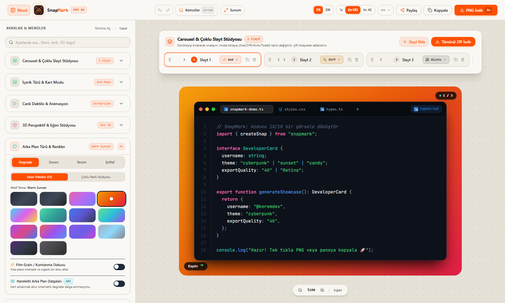

# 📸 SnapMark — 4K Code, Diff & Social Media Carousel Studio
### *Next-Generation Developer Screenshot & Multi-Slide Presentation Atelier*

<div align="center">

[](https://nextjs.org/)
[](https://www.typescriptlang.org/)
[](https://tailwindcss.com/)
[](https://prismjs.com/)
[](https://github.com)
[](./LICENSE)

**[🇹🇷 Türkçe](#-türkçe) &nbsp;|&nbsp; [🇬🇧 English](#-english) &nbsp;|&nbsp; [📄 Standalone English Manual (README.en.md)](./README.en.md)**

</div>

---

<div align="center">
  
</div>

---

<a id="-türkçe"></a>
## 🇹🇷 Türkçe

### 🎯 1. Vizyon & Çözülen Problem
Yazılımcılar, içerik üreticileri ve teknik liderler; Twitter (X), LinkedIn ve Instagram'da kod veya teknik not paylaşırken ekran görüntüsü alıp kırpmakla, hizalama bozulmalarıyla ve piksellerin bulanıklaşmasıyla uğraşmaktadır. Carbon ve Ray.so gibi popüler araçlar yalnızca tek bir kod bloğunu desteklerken, sosyal medyada en yüksek etkileşimi alan **kaydırmalı gönderiler (Carousels)** için birden fazla slayt üretme ve bunları tek seferde indirme desteği sunmazlar.

**SnapMark**, bu problemi kökten çözmek için tasarlanmış bağımsız, açık kaynaklı ve %100 istemci taraflı (client-side) bir görsel stüdyodur. Kod parçacıklarını, Git farklarını (diff), tweet alıntılarını ve terminal çıktılarını 4K Ultra HD çözünürlükte sosyal medya kartlarına dönüştürür.

---

### ⚖️ 2. Alternatiflerle Karşılaştırma

| Özellik | SnapMark | Carbon.now.sh | Ray.so |
|:---|:---:|:---:|:---:|
| **Çoklu Slayt (Carousel) & ZIP İndirme** | ✅ **Var (Sürükle-Bırak)** | ❌ Yok | ❌ Yok |
| **Kart Modları** | ✅ **Kod, Diff, Alıntı, CLI** | ⚠️ Yalnızca Kod | ⚠️ Yalnızca Kod |
| **Git Diff (+ / - Renklendirme)** | ✅ **Özel Diff Modu** | ❌ Yok | ❌ Yok |
| **Özel Çoklu Duraklı Gradyan Stüdyosu** | ✅ **Var (Açı, Tip, Renkler)** | ⚠️ Sınırlı Hazır Temalar | ⚠️ Sınırlı Hazır Temalar |
| **Sosyal Medya En Boy Oranları** | ✅ **16:9, 1:1, 4:5, Otomatik** | ⚠️ Yalnızca Dolgu | ⚠️ Yalnızca Dolgu |
| **Veri Gizliliği (Zero-Server)** | ✅ **%100 Tarayıcı Belleği** | ⚠️ Kısmi Harici Varlıklar | ⚠️ Kısmi Harici Varlıklar |
| **Doğrudan Panoya Kopyalama (`Ctrl+V`)** | ✅ **Var (Async Clipboard API)** | ⚠️ Tarayıcıya Göre Değişir | ⚠️ Tarayıcıya Göre Değişir |

---

### ✨ 3. Öne Çıkan Özellikler

- **5 Özel Kart Sunum Modu:**
  - `Kod Modu`: JavaScript, TypeScript, Python, HTML, CSS, JSON, Rust, Go, Java, Kotlin, Swift, PHP, Ruby, SQL, Bash, Markdown, C, C++, C#, YAML, Docker, GraphQL, TSX dahil 23 dilde Prism.js sözdizimi renklendirmesi.
  - `Diff Modu`: Gerçek satır bazlı LCS fark algoritması, eklenen (+) yeşil ve silinen (-) kırmızı vurgulaması, tek sütun birleşik veya iki sütun yan yana (side-by-side) karşılaştırma.
  - `Alıntı Modu`: Özel avatar, yazar adı, unvanı ve tırnak tipografisiyle kitap alıntıları ve düşünce vitrini.
  - `Tweet (X) Modu`: Doğrulanmış rozet (Mavi/Altın/Gri), metrik sayaçları (beğeni, retweet, yanıt, görüntülenme) ile piksel netliğinde sosyal paylaşım kartı.
  - `Terminal CLI Modu`: macOS / Linux pencere kontrolleri, kullanıcı komut satırı ve renkli terminal çıktıları.
- **Canlı WebM Video Animasyon Dışa Aktarımı:**
  - Canlı daktilo ve parlama animasyonlarını doğrudan WebM video formatında kaydedip Twitter/X ve LinkedIn'de paylaşma.
- **Warm Alabaster & Teenage Engineering Estetiği:**
  - Dieter Rams ve Teenage Engineering esintili sıcak alabaster arayüz (`#F4F1EA`), turuncu vurgular (`#FF4F00`) ve mühendislik ızgara dokusu.
- **Carousel Studio & Sürükle-Bırak Sıralama:**
  - Sayfadan ayrılmadan 10'larca slayt ekleyin, kopyalayın, adlandırın ve sürükle-bırak ile sıralayın.
  - Tek tıkla tüm slaytları yüksek çözünürlüklü tek bir **ZIP** arşivi olarak indirin.
- **Sinematik Arka Planlar & Doku:**
  - 12 hazır gradyan paleti veya renk çarkından açısını ve türünü (Doğrusal, Dairesel, Konik) ayarlayabileceğiniz özel stüdyo.
  - Desen motoru: Izgara (Grid), Nokta (Dots), İzometrik ve Geometrik dokular.
  - Ayarlanabilir **Film Grain (Kumlanma)** dokusu ile analog stüdyo hissi.
- **Pencere Stilleri & Dışa Aktarma:**
  - macOS (Kırmızı/Sarı/Yeşil), Windows veya Çerçevesiz minimalist kart stilleri.
  - 1x, 2x, 4x Ultra HD PNG, SVG vektör ve tek tıkla doğrudan panoya kopyalama.

---

### 🏛️ 4. Teknik Mimari & Dizin Yapısı

SnapMark, harici hiçbir sunucu API'sine veya arka uç servisine ihtiyaç duymaz. Ekran görüntüsü alma işlemi HTML5 Canvas ve SVG ForeignObject kullanan `html-to-image` motoruyla tamamen yerel bellekte gerçekleşir:

```
01-SnapMark/
├── public/
│   └── screenshot.png          # Yüksek çözünürlüklü vitrin görseli
├── src/
│   ├── app/
│   │   ├── layout.tsx          # Kök HTML & Font yükleyici
│   │   ├── page.tsx            # Karşılama & vitrin sayfası
│   │   ├── studio/page.tsx     # Ana SnapMark tuval & kontrol stüdyosu
│   │   └── globals.css         # Tailwind direktifleri ve özel stiller
│   ├── components/
│   │   ├── CarouselNav.tsx     # Çoklu slayt yöneticisi & ZIP dışa aktarıcı
│   │   ├── CodeEditor.tsx      # Monaco / Prism sözdizimi editörü
│   │   ├── Controls.tsx        # Sol ayar paneli (arka plan, pencere, dolgu)
│   │   ├── Header.tsx          # Üst bar, içe/dışa aktar, GitHub Gist çekici
│   │   ├── Logo.tsx            # SnapMark vektörel marka kilidi
│   │   ├── PreviewCard.tsx     # Canlı render edilen DOM kart bileşeni
│   │   └── Toast.tsx           # İşlem bildirim sistemi
│   ├── lib/
│   │   ├── constants.ts        # Varsayılan şablonlar, diller ve gradyanlar
│   │   ├── i18n.ts             # Türkçe / İngilizce sözlük motoru
│   │   └── colorTable.ts       # HSL/RGB renk dönüştürme yardımcıları
│   └── types/
│       └── index.ts            # CardConfig, Slide ve mod veri modelleri
├── package.json
├── tailwind.config.js
├── tsconfig.json
└── LICENSE
```

---

### 🎨 5. Tasarım Sistemi & Renk Paleti

| Tasarım Ögesi | Değer / Token | Kullanım Alanı |
|---|---|---|
| **Ana Zemin** | `#FAF8F5` | Tuval çalışma alanı ve açık krem zemin |
| **Konteyner & Kart** | `#18181B` | Kontrol panelleri, kod kartı antrasit gövdesi |
| **Alev Vurgusu** | `#FF4F00` / `#EA580C` | Birincil aksiyonlar, aktif sekmeler, marka rengi |
| **Metin Ana** | `#18181B` (Açık mod) / `#FAF8F5` (Koyu mod) | Başlıklar ve okunabilir kod blokları |
| **Kod Tipografisi** | `JetBrains Mono, monospace` | Sözdizimi, satır sayıları ve etiketler |
| **Arayüz Tipografisi** | `IBM Plex Sans, sans-serif` | Kontrol butonları, menüler ve araç ipuçları |

---

### 🚀 6. Kurulum ve Çalıştırma

Gereksinimler: **Node.js 18+** ve npm.

```bash
# 1. Depoyu klonlayın
git clone https://github.com/your-username/snapmark.git
cd snapmark

# 2. Bağımlılıkları yükleyin
npm install

# 3. Geliştirme sunucusunu başlatın
npm run dev
# Tarayıcınızda http://localhost:3000 veya http://localhost:3000/studio adresini açın!

# 4. Üretim sürümünü derleyin
npm run build
npm run start
```

---

<a id="-english"></a>
## 🇬🇧 English

### 🎯 1. Overview & Problem Solved
Sharing snippets, technical tutorials, and product updates on social media (X/Twitter, LinkedIn, Instagram) is painful. Developers struggle with manual screenshots, fuzzy font scaling, and broken alignment. While tools like Carbon and Ray.so support basic code snippets, they do not accommodate multi-slide carousel posts, which generate the highest technical engagement on LinkedIn and Instagram.

**SnapMark** is a standalone, open-source, 100% client-side studio engineered to transform code snippets, Git diffs, tweet quotes, and terminal sessions into publication-ready **4K Ultra HD social media cards and multi-slide carousels** with single-click bulk ZIP export.

---

### ⚖️ 2. Comparison Matrix

| Capability | SnapMark | Carbon.now.sh | Ray.so |
|:---|:---:|:---:|:---:|
| **Multi-Slide Carousel & Bulk ZIP** | ✅ **Built-in (Drag & Drop)** | ❌ None | ❌ None |
| **Card Presentation Modes** | ✅ **Code, Diff, Quote, CLI** | ⚠️ Code Only | ⚠️ Code Only |
| **Git Diff Syntax (+ / - coloring)** | ✅ **Dedicated Diff Mode** | ❌ None | ❌ None |
| **Custom Multi-Stop Gradient Studio** | ✅ **Yes (Angle, Type, Color Stops)**| ⚠️ Preset Palettes Only | ⚠️ Preset Palettes Only |
| **Social Media Aspect Ratios** | ✅ **16:9, 1:1, 4:5, Auto** | ⚠️ Padding Only | ⚠️ Padding Only |
| **Privacy (Zero Data Leak)** | ✅ **100% In-Browser Memory** | ⚠️ Partial External CDNs | ⚠️ Partial External CDNs |
| **Direct Clipboard Copy (`Ctrl+V`)** | ✅ **Supported (Async Clipboard)** | ⚠️ Browser Dependent | ⚠️ Browser Dependent |

---

### ✨ 3. Key Capabilities

- **4 Card Modes:** Code (20+ Prism.js languages), Git Diff (green additions / red deletions), Quote (author avatar, @handle, editorial typography), and Terminal CLI (macOS/Linux style).
- **Carousel Studio:** Create multi-page slide decks, reorder via drag-and-drop, and download every slide at once in a single **ZIP** archive.
- **Backdrop Artistry:** 12 curated studio gradients, custom multi-stop gradient editor (linear, radial, conic), geometric pattern overlays, and real film grain textures.
- **Window Frames & DPI Scaling:** macOS window chrome, Windows border, or frameless clean container. Exports 1x, 2x, 4x Ultra HD PNG, SVG vector, or direct clipboard copy.

---

### 🏛️ 4. Project Structure

```
01-SnapMark/
├── public/screenshot.png       # High-DPI showcase asset
├── src/
│   ├── app/                    # Next.js 15 App Router pages & styles
│   ├── components/             # CarouselNav, CodeEditor, Controls, PreviewCard
│   ├── lib/                    # i18n dictionary, color converters, constants
│   └── types/                  # Strict TypeScript domain interfaces
├── package.json
├── tailwind.config.js
└── LICENSE
```

---

### 🎨 5. Design Tokens

- **Canvas Base:** Warm Alabaster (`#FAF8F5`)
- **Card Chassis:** Anthracite Graphite (`#18181B`)
- **Accent Highlight:** Flame Orange (`#FF4F00` / `#EA580C`)
- **Typography:** `JetBrains Mono` for code & line numbers, `IBM Plex Sans` for UI labels

---

### 🚀 6. Getting Started

```bash
# 1. Clone repository
git clone https://github.com/your-username/snapmark.git
cd snapmark

# 2. Install dependencies
npm install

# 3. Start local studio (Port 3000)
npm run dev
# Open http://localhost:3000/studio in your browser!

# 4. Production build
npm run build
npm run start
```

---

### 📜 License
Released under the [MIT License](./LICENSE). Free for personal and commercial usage.
